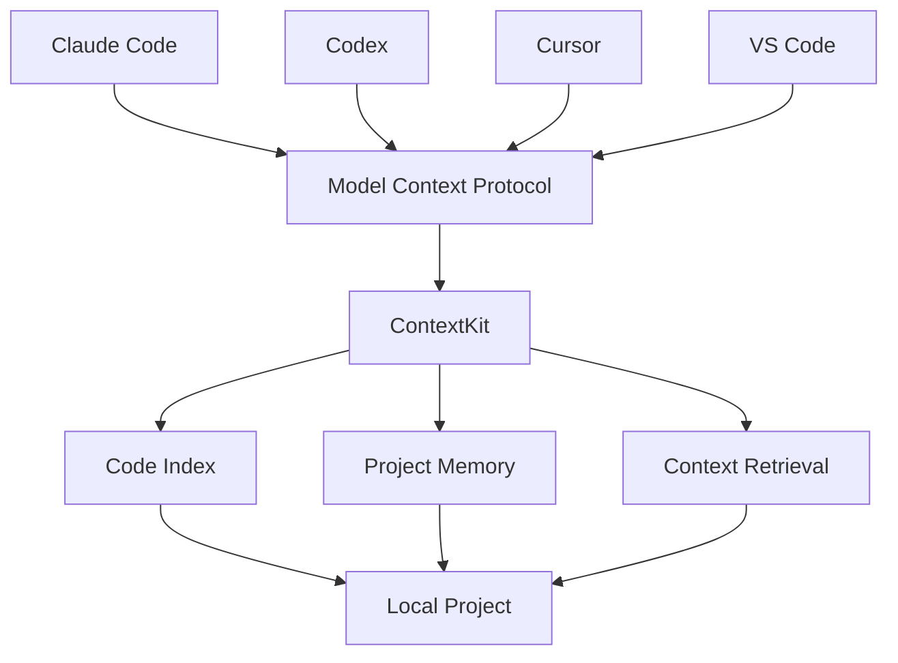

<div align="center">

  

  <h3>One project. Shared context. Persistent memory.</h3>

  <p>
    Local-first context infrastructure for AI coding agents.<br />
    Switch assistants without starting over.
  </p>

  <a href="https://github.com/ipairss/ContextKit/releases/latest">
    
  </a>
  <a href="https://github.com/ipairss/ContextKit/actions/workflows/ci.yml">
    
  </a>
  <a href="https://www.rust-lang.org/">
    
  </a>
  <a href="https://modelcontextprotocol.io/">
    
  </a>
  <a href="LICENSE">
    
  </a>

  <br /><br />

  <a href="#installation"><b>Installation</b></a>
  &nbsp;&nbsp;·&nbsp;&nbsp;
  <a href="#quick-start"><b>Quick start</b></a>
  &nbsp;&nbsp;·&nbsp;&nbsp;
  <a href="#integrations"><b>Integrations</b></a>
  &nbsp;&nbsp;·&nbsp;&nbsp;
  <a href="#documentation"><b>Documentation</b></a>
  &nbsp;&nbsp;·&nbsp;&nbsp;
  <a href="https://github.com/ipairss/ContextKit/issues"><b>Issues</b></a>

</div>

<br />

---

## Overview

AI coding assistants lose context between sessions. Project conventions, architectural decisions, unfinished work and previous discoveries have to be explained again and again.

ContextKit gives your project a persistent, searchable memory that lives alongside your code and works across different assistants.

No accounts. No API keys. No external services.

<table>
  <tr>
    <td width="50%" valign="top">
      <h3>Context retrieval</h3>
      <p>Retrieve relevant code, symbols and project information without loading the entire repository into an assistant's context window.</p>
    </td>
    <td width="50%" valign="top">
      <h3>Persistent memory</h3>
      <p>Preserve decisions, conventions, requirements, known bugs and unfinished tasks across sessions.</p>
    </td>
  </tr>
  <tr>
    <td width="50%" valign="top">
      <h3>Cross-agent compatibility</h3>
      <p>Move between Claude Code, Codex, Cursor and other MCP clients without rebuilding project context.</p>
    </td>
    <td width="50%" valign="top">
      <h3>Local-first architecture</h3>
      <p>Your index and project memory remain on your machine. No cloud infrastructure or telemetry.</p>
    </td>
  </tr>
</table>

<br />

## How it works



ContextKit indexes your repository and exposes its structure and memory through the Model Context Protocol.

When an assistant requests context, ContextKit retrieves relevant source files, symbols, project rules and previous decisions.

All connected assistants work with the same underlying project knowledge.

<br />

## Performance

<div align="center">

<table>
  <tr>
    <td align="center" width="33%">
      <h1>~11 MB</h1>
      <sub>Binary size</sub>
    </td>
    <td align="center" width="33%">
      <h1>~10 ms</h1>
      <sub>Startup time</sub>
    </td>
    <td align="center" width="33%">
      <h1>~6 MB</h1>
      <sub>Idle memory</sub>
    </td>
  </tr>
</table>

<sub>Approximate measurements. Results may vary by platform and project.</sub>

</div>

<br />

Built in Rust with incremental indexing. Only changed files are reprocessed.

ContextKit does not require a background AI model, external database server or hosted API.

See the [architecture documentation](docs/architecture.md) for implementation details.

---

## Installation

### Prebuilt binaries

Download the appropriate binary from the [latest release](https://github.com/ipairss/ContextKit/releases/latest).

| Platform | Architecture | Package suffix |
| :--- | :--- | :--- |
| Windows | x86-64 | `x86_64-pc-windows-msvc.zip` |
| macOS | Apple Silicon | `aarch64-apple-darwin.tar.gz` |
| macOS | Intel | `x86_64-apple-darwin.tar.gz` |
| Linux | x86-64 | `x86_64-unknown-linux-gnu.tar.gz` |
| Linux | ARM64 | `aarch64-unknown-linux-gnu.tar.gz` |

Extract the archive and add the executable to your `PATH`.

Verify your installation:

```sh
contextkit --version
```

Platform-specific instructions are available in the [installation guide](docs/getting-started.md#1-install).

<details>
<summary><b>Build from source</b></summary>

<br />

Requirements:

- Rust 1.91 or newer
- Cargo
- A C compiler
- Windows: Visual Studio Build Tools with Desktop development with C++

```sh
git clone https://github.com/ipairss/ContextKit.git
cd ContextKit
cargo install --path .
```

Install Rust from [rustup.rs](https://rustup.rs/).

</details>

<br />

## Quick start

### 01 / Initialize your project

Open a terminal in your project's root directory.

```sh
contextkit init
```

ContextKit indexes your source code while excluding ignored files, dependency directories, build artifacts and detected secrets.

### 02 / Connect your assistant

Choose the assistant you use.

```sh
contextkit setup claude
contextkit setup codex
contextkit setup cursor
contextkit setup vscode
```

### 03 / Start working

Restart your assistant or open a new session.

Your assistant can now retrieve project context and interact with persistent memory through MCP.

> [!TIP]
> Run `contextkit status` to inspect the index, or use `contextkit context "your task"` to preview the context an assistant would receive.

---

## Project memory

ContextKit stores knowledge that would otherwise disappear when a conversation ends.

<table>
  <tr>
    <th align="left">Without ContextKit</th>
    <th align="left">With ContextKit</th>
  </tr>
  <tr>
    <td>Repeat project conventions</td>
    <td>Retrieve existing conventions</td>
  </tr>
  <tr>
    <td>Explain previous decisions</td>
    <td>Read recorded decisions</td>
  </tr>
  <tr>
    <td>Reconstruct unfinished work</td>
    <td>Retrieve open tasks</td>
  </tr>
  <tr>
    <td>Rediscover relevant source files</td>
    <td>Search the existing code index</td>
  </tr>
  <tr>
    <td>Lose context when switching assistants</td>
    <td>Continue with shared project memory</td>
  </tr>
</table>

### Define your project rules

```sh
contextkit memory add -c convention -t "Use tabs, not spaces"

contextkit memory add -c instruction -t "Never edit files in src/generated/"

contextkit memory add -c decision -t "We use SQLite" -b "No external database server required."
```

User-defined conventions and instructions are included in every context retrieval.

### Review assistant-generated memories

Memories created by an assistant are marked as unverified.

```sh
# Review pending memories
contextkit memory list --status unverified

# Approve a memory
contextkit memory verify <id>

# Remove an incorrect memory
contextkit memory delete <id>
```

Assistants cannot verify their own memories, modify verified records or delete existing memories.

You remain in control of what becomes an official project fact.

<details>
<summary><b>Available memory categories</b></summary>

<br />

| Category | Description |
| :--- | :--- |
| `decision` | Architectural or implementation decisions |
| `convention` | Coding conventions and style rules |
| `instruction` | Persistent assistant instructions |
| `requirement` | Project requirements and constraints |
| `task_open` | Unfinished work |
| `task_done` | Completed work |
| `bug` | Known issues |
| `discovery` | Information discovered during development |
| `dependency` | Dependency choices and reasoning |

</details>

### Share memory with your team

Export project knowledge into a portable JSON file.

```sh
contextkit memory export -o .contextkit/memory.json
```

Other contributors can import it:

```sh
contextkit memory import .contextkit/memory.json
```

> [!NOTE]
> Imported memories are unverified by default. Review exported memories for sensitive information before committing them to a repository.

---

## Integrations

<div align="center">

<table>
  <tr>
    <td align="center" width="25%">
      
      <br /><br />
      <b>Claude Code</b>
      <br />
      <sub>Supported</sub>
    </td>
    <td align="center" width="25%">
      
      <br /><br />
      <b>Codex</b>
      <br />
      <sub>Tested</sub>
    </td>
    <td align="center" width="25%">
      
      <br /><br />
      <b>Cursor</b>
      <br />
      <sub>Supported</sub>
    </td>
    <td align="center" width="25%">
      
      <br /><br />
      <b>VS Code</b>
      <br />
      <sub>Supported</sub>
    </td>
  </tr>
</table>

</div>

| Client | Integration | Validation |
| :--- | :--- | :--- |
| Codex | MCP | Tested |
| Claude Code | MCP | Client testing pending |
| Cursor | MCP | Client testing pending |
| VS Code / Copilot | MCP | Client testing pending |
| Other MCP clients | Standard protocol | Client-dependent |

See the [integration guide](docs/integrations.md) for configuration details.

<br />

## Language support

<div align="center">

  

  <br /><br />

  <b>Rust · JavaScript · TypeScript · Python · Lua · Luau · Markdown</b>

</div>

<br />

ContextKit understands the structure of supported languages, enabling symbol-aware search and retrieval.

Other text-based files, including Go, C#, configuration files and documentation, remain searchable through the text index.

---

## Command reference

| Command | Description |
| :--- | :--- |
| `contextkit init` | Initialize a project |
| `contextkit setup <assistant>` | Configure an MCP integration |
| `contextkit status` | Display index and memory statistics |
| `contextkit overview` | Display the project structure and open tasks |
| `contextkit context "task"` | Retrieve context for a specific task |
| `contextkit search "text"` | Search indexed source files |
| `contextkit symbol <name>` | Locate a function, class or symbol |
| `contextkit index` | Manually refresh the index |
| `contextkit watch` | Watch for file changes |
| `contextkit memory` | Manage persistent project memory |

<details>
<summary><b>Memory commands</b></summary>

<br />

| Subcommand | Description |
| :--- | :--- |
| `memory add` | Create a memory |
| `memory list` | List stored memories |
| `memory search` | Search memories |
| `memory show` | Inspect a memory |
| `memory update` | Update a memory |
| `memory verify` | Approve a memory |
| `memory delete` | Remove a memory |
| `memory export` | Export project memory |
| `memory import` | Import project memory |

</details>

For additional options:

```sh
contextkit <command> --help
```

Use `--refs` with the symbol command to retrieve references to a symbol.

---

## Privacy & security

ContextKit is designed to operate entirely on your machine.

| Principle | Implementation |
| :--- | :--- |
| Local execution | No cloud services, accounts or telemetry |
| Secret filtering | Excludes credential files and detected API keys |
| Project isolation | Restricts file access to indexed project files |
| Memory integrity | Assistant-generated records require user verification |
| User ownership | Local storage with import and export support |

Common credential formats, private keys, certificates and `.env` files are excluded from indexing.

> [!IMPORTANT]
> ContextKit itself does not send data over the network. Connected AI assistants may still transmit retrieved context to their respective providers.
>
> Secret detection is not exhaustive. Keep credentials and sensitive information out of source files.

Read the full [security policy](SECURITY.md) for the threat model and vulnerability reporting process.

<br />

## Frequently asked questions

<details>
<summary><b>Does ContextKit require an API key?</b></summary>

<br />

No. ContextKit does not use external AI services or require an account.

</details>

<details>
<summary><b>Does ContextKit send my source code anywhere?</b></summary>

<br />

No. ContextKit itself operates locally. Your connected assistant may send retrieved context to its AI provider.

</details>

<details>
<summary><b>Will it slow down my computer?</b></summary>

<br />

ContextKit is a lightweight native Rust application. It uses incremental indexing to avoid repeatedly processing unchanged files.

Actual resource usage depends on the size and structure of your project.

</details>

<details>
<summary><b>Where is my project data stored?</b></summary>

<br />

Inside the `.contextkit/` directory in your project's root.

Deleting this directory removes the index and stored memories. Export your memories first if you want to preserve them.

</details>

<details>
<summary><b>My assistant isn't using ContextKit. What should I do?</b></summary>

<br />

Run the appropriate setup command again from your project root:

```sh
contextkit setup <assistant>
```

Restart the assistant and ask it to call `get_context` for a specific task.

See the [troubleshooting guide](docs/getting-started.md#if-something-doesnt-work) for more information.

</details>

---

## Documentation

| Resource | Description |
| :--- | :--- |
| [Getting started](docs/getting-started.md) | Installation and initial configuration |
| [Integrations](docs/integrations.md) | MCP clients and available tools |
| [Architecture](docs/architecture.md) | Internals, indexing and retrieval |
| [Security](SECURITY.md) | Security model and vulnerability reporting |
| [Contributing](CONTRIBUTING.md) | Development, testing and contributions |
| [Changelog](CHANGELOG.md) | Release history |

## Roadmap

- [x] Local project indexing
- [x] Symbol-aware retrieval
- [x] Persistent project memory
- [x] MCP integration
- [x] Memory import and export
- [x] Incremental indexing
- [ ] Complete real-client integration testing
- [ ] Homebrew, Scoop and winget packages
- [ ] Additional language parsers
- [ ] Optional semantic search

Feature requests and bug reports are welcome through [GitHub Issues](https://github.com/ipairss/ContextKit/issues).

## Contributing

Contributions are welcome.

Before submitting a pull request, read the [contribution guidelines](CONTRIBUTING.md).

## License

ContextKit is distributed under the [MIT License](LICENSE).

<br />

---

<div align="center">

  

  <p>
    <sub>Built with Rust. Designed for developers.</sub>
  </p>

  <sub>
    Maintained by <a href="https://github.com/ipairss"><b>ipairss</b></a>
  </sub>

  <br /><br />

  <a href="https://github.com/ipairss/ContextKit/stargazers">
    
  </a>
  <a href="https://github.com/ipairss/ContextKit/network/members">
    
  </a>

</div>
