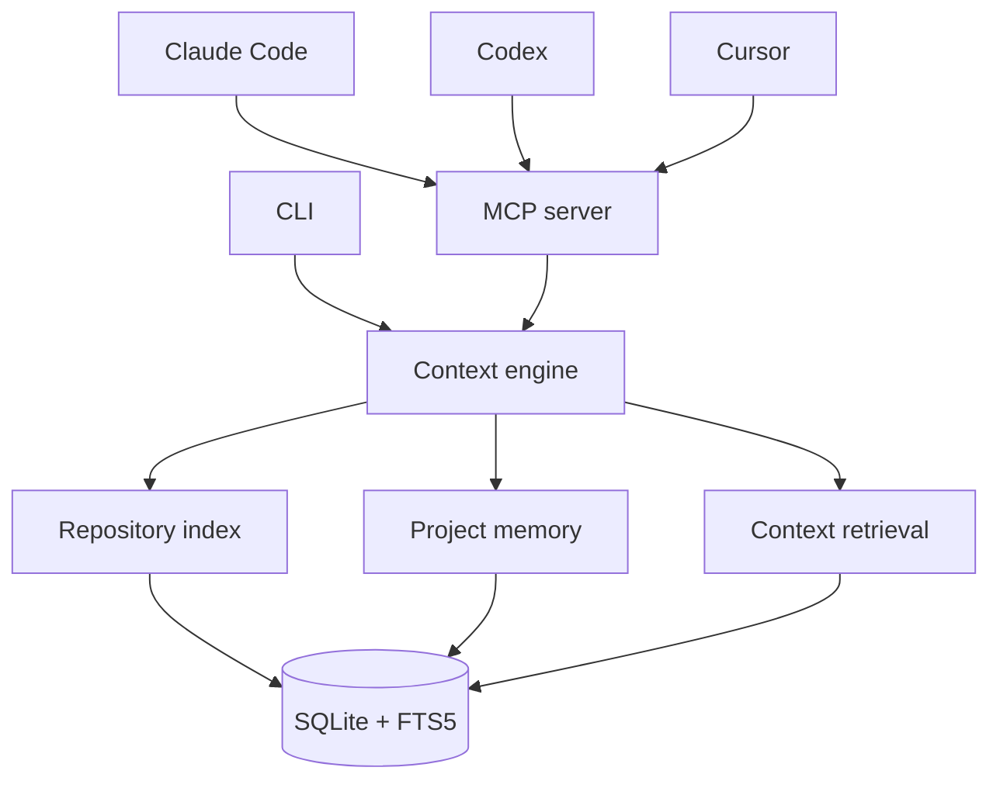

# How ContextKit works

This page is for contributors and the curious. To use ContextKit, the [README](../README.md) and the [getting started guide](getting-started.md) are enough.

## Architecture

Each assistant starts its own `contextkit mcp` process. All processes and the CLI share one SQLite database in WAL mode, which is how memory moves between agents.

## Indexing pipeline

1. Walk the repository, honoring `.gitignore`, `.contextkitignore`, `index.exclude` and the built-in exclusions.
2. Skip files whose size and modification time match the database. Nothing else is read.
3. Read, hash (BLAKE3) and parse changed files on worker threads. A file whose hash matches what is stored only has its metadata updated.
4. Write all results on one thread, in one transaction.
5. Pair deleted and added files with identical content as renames, and move memory links to the new path.
6. Resolve imports to files, for related-file lookups.

## Retrieval

Candidates come from verified project rules, memory full-text hits, symbol name matches and code full-text hits (BM25). Each candidate is scored by simple, documented signals in `context::weights`:

- Exact symbol match (stronger when the term looks like code, such as `parse_config`).
- How many task words a symbol name contains.
- Path matches and focus paths.
- Import neighbors of the top results.
- Memory linked to top files.
- Memory recency.
- A penalty for unverified memory.

Overlapping ranges merge. Items are packed greedily into the budget, and large snippets shrink before they are dropped. The same index and query always give the same result.

Token counts are **estimates** (UTF-8 bytes / 4) and are labelled as such in every output. ContextKit does not ship a tokenizer, so it cannot give exact counts.

## Source layout

| Path | Purpose |
| :--- | :--- |
| `src/main.rs` | The CLI. |
| `src/mcp.rs` | The MCP stdio server and tool definitions. |
| `src/context.rs` | Scoring, budget packing and rendering. |
| `src/search.rs` | Query parsing, code search, symbols, references, file relations. |
| `src/memory.rs` | Memory records, the trust model, export and import. |
| `src/overview.rs` | Project overview. |
| `src/index/` | Walker, language detection, tree-sitter extraction, manifests, import resolution, pipeline. |
| `src/watch.rs` | Debounced reindexing on file changes. |
| `src/db.rs` | Connection setup and schema migrations. |
| `src/config.rs`, `src/project.rs` | Configuration and project discovery. |
| `tests/end_to_end.rs` | Indexing lifecycle, retrieval, memory rules and MCP protocol tests. |

## Data on disk

| File | Commit it? | Contents |
| :--- | :--- | :--- |
| `.contextkit/config.toml` | Yes | Project configuration (commented defaults are written by `init`). |
| `.contextkit/.gitignore` | Yes | Keeps the database out of version control. |
| `.contextkit/contextkit.db` | No | Index and project memory. |
| `.contextkitignore` | Yes | Extra exclusions, in gitignore syntax. |

The database holds memory as well as the index. To share memory through version control, commit a `memory export` and run `memory import` on other machines.

## Design Principles

- **Local first.** Project data stays on your machine.
- **Provider independent.** No dependency on a specific AI model or provider.
- **Lightweight.** A native executable with no runtime and no async runtime.
- **Deterministic.** Retrieval needs no language model or embedding service.
- **Incremental.** Only changed files are reindexed.
- **Transparent.** Retrieved context names its source paths, line ranges, scores and reasons.
- **Minimal.** Every dependency and abstraction must justify itself.

## Technology

| Component | Technology |
| :--- | :--- |
| Core | Rust (stable, 2024 edition, MSRV 1.91) |
| Storage | SQLite via `rusqlite` (bundled) |
| Full-text search | FTS5 |
| Source parsing | Tree-sitter |
| Ignore rules | `ignore` (the walker used by ripgrep) |
| Content hashing | BLAKE3 |
| CLI | Clap |
| Serialization | Serde, `serde_json`, `toml` |
| File monitoring | Notify |
| Agent communication | MCP over stdio (implemented directly, no SDK) |

All dependency licenses are permissive (MIT, Apache-2.0, ISC, BSL-1.0, Zlib, Unlicense, CC0-1.0). `deny.toml` enforces this in CI.

## Performance

| Metric | Target | Measured |
| :--- | :--- | :--- |
| CLI startup (`--version`) | Below 100 ms | 8–17 ms |
| `status` | | 10–15 ms |
| Idle MCP server memory | About 15 MB | 5.7 MiB working set, 1.0 MiB private |
| MCP server after a `get_context` call | | 8.1 MiB working set |
| Full index, this repository (26 files) | | 125 ms |
| Incremental index, nothing changed | | 9 ms |
| Release binary size | | 11.1 MiB |

Measured once on a Windows 10 desktop with a release build, on this repository. These are spot checks, not benchmarks. Reproducible benchmarks on larger repositories are on the roadmap.

## Test coverage

61 automated tests (56 unit, 5 end-to-end) run in CI on Linux (x86_64, ARM64), macOS (ARM64) and Windows (x86_64), together with `cargo fmt`, `cargo clippy -D warnings`, `cargo deny`, a minimum-Rust-version build (1.91) and four fuzz targets.
